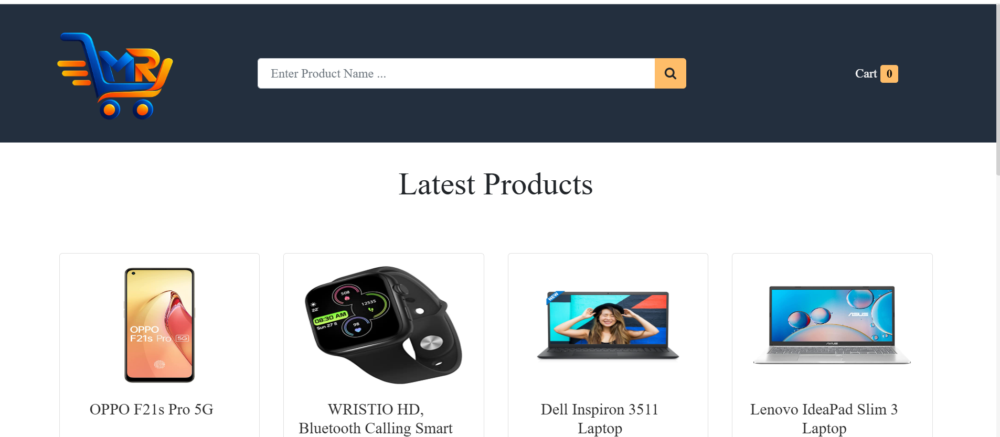
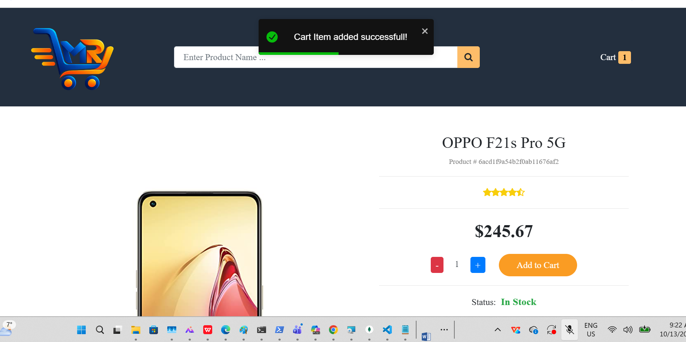

# Mini E-Commerce

A modern and responsive Mini E-Commerce web application built using React. This project allows users to browse products, search items, add products to the cart, and manage orders through a simple and user-friendly interface.

## 🌐 Live Demo

🔗 https://malar172.github.io/Mini-ecommerce/

## 🚀 Features

- Product Listing
- Product Search
- Product Details Page
- Add to Cart
- Cart Management
- Responsive Design
- React Router Navigation
- Modern User Interface

## 🛠️ Technologies Used

- React.js
- JavaScript
- HTML5
- CSS3
- React Router DOM
- Bootstrap/Tailwind CSS

## 📂 Project Structure
Mini-ecommerce
│
├── frontend
│   ├── public
│   │   └── Static assets
│   │
│   ├── src
│   │   ├── components
│   │   │   └── Reusable React components
│   │   │
│   │   ├── pages
│   │   │   └── Application pages
│   │   │
│   │   ├── App.js
│   │   │   └── Main application component
│   │   │
│   │   └── index.js
│   │       └── React entry point
│   │
│   └── package.json
│       └── Project dependencies and scripts
│
└── backend
    ├── Controllers
    ├── Routes
    ├── Models
    ├── Database Configuration
    └── API Services
Install dependencies
Shell
npm install
Start the development server
Shell
npm start
## Screenshots

### Home Page

### Product Page

### Cart Page

## 🚀 Live Demo
 
[View Mini E-Commerce Website](https://malar172.github.io/Mini-ecommerce/)

🎯 Purpose

This project was developed as a learning project to improve skills in:

React Development
Frontend Design
Routing
State Management
Web Application Development
👩‍💻 Author

Malarvizhi Raju

GitHub: https://github.com/malar172

📜 License

This project is created for educational purposes.
    
